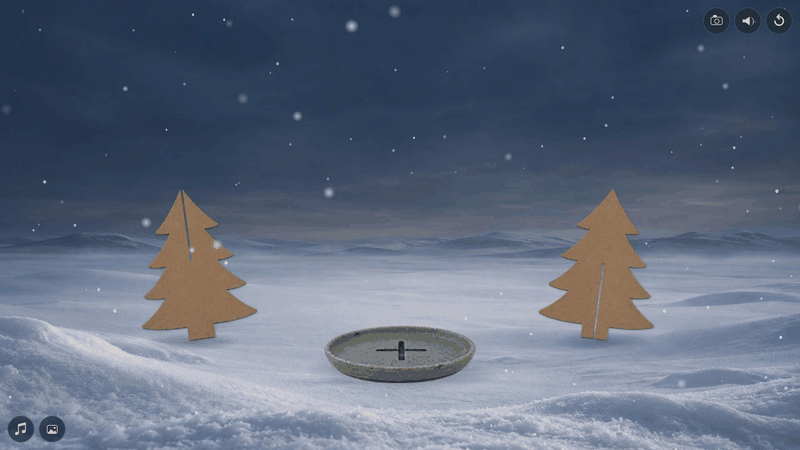

# 魔法开花圣诞树

我把小时候那种浇水就会「开花」的纸板圣诞树做成了一个雪地互动作品。想玩一遍童年玩具、和朋友体验一个短小的节日互动，都可以从两片纸板开始，亲手种出一棵会发光的圣诞树。

小时候最期待的是浇完水后，隔一会儿跑去看纸树有没有长出第一簇结晶。我想把这种期待放进浏览器里，让拼装、等待生长和最后点亮星星都由玩家完成。

## 能做什么

- **拼装和种树。** 两片纸板任选一片先插，再安上树顶星。浇水后，松针分簇长出，直到盖住纸板。
- **点亮和转树。** 挥一下手，金光沿枝叶盘旋而上并点亮星星。树长成后，可以转到侧面、背面看灯光和挂件。
- **打开自己的节日照片。** 选入的照片由浏览器在本机读取，平时隐藏。树完成后可以打开照片，选一张拉近看，再收回去。
- **用手或鼠标操作。** 开启摄像头可用捏合拿取、横向点赞浇水、食指挥动施法。用鼠标可以拖动道具、挥动施法、转树，也可以点击照片看大图。

## 从两片纸板到星星点亮

演示从雪地里的两片纸板开始。先拖动两片纸板完成拼装，放上暗着的星星，再把水壶移到树尖。松针长满后，在画面上拖一小段，让金光绕树而上。最后打开事先选入的示例照片，放大看一张，再回到雪景。

动图录自实际运行的作品，使用鼠标操作。照片查看环节使用虚构的冬日明信片。
